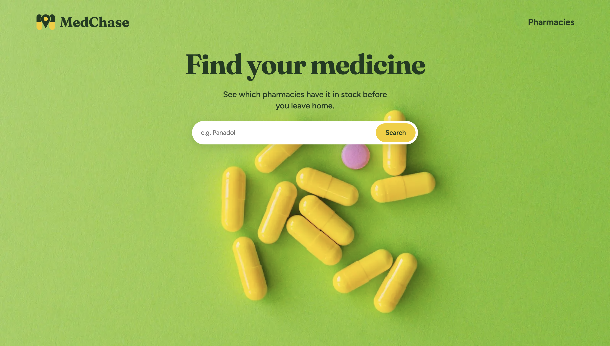
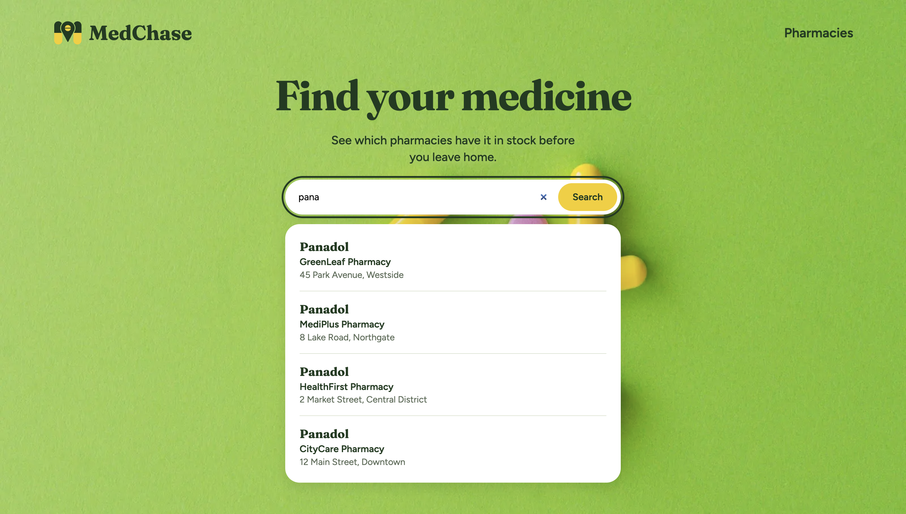
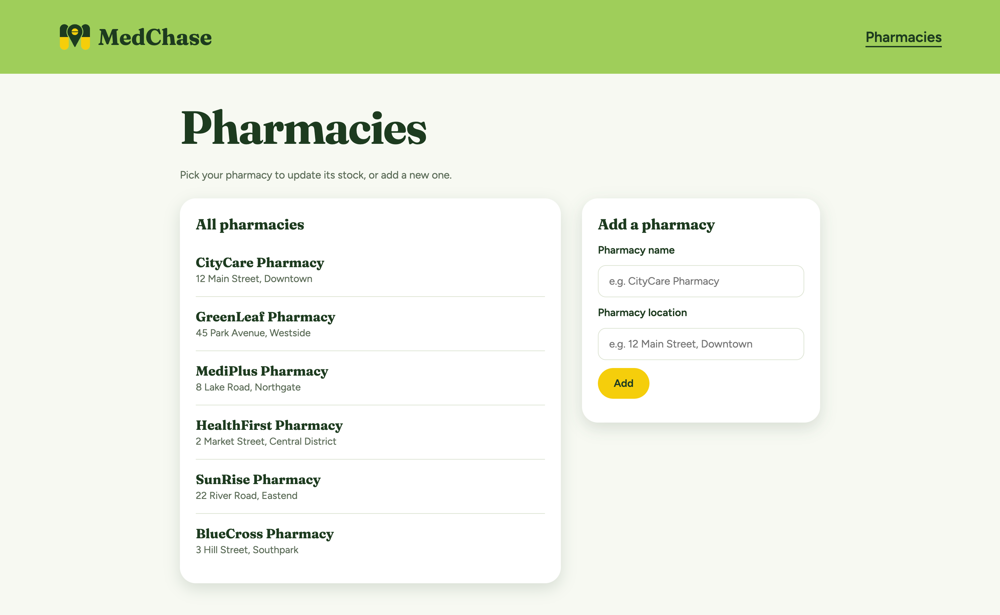
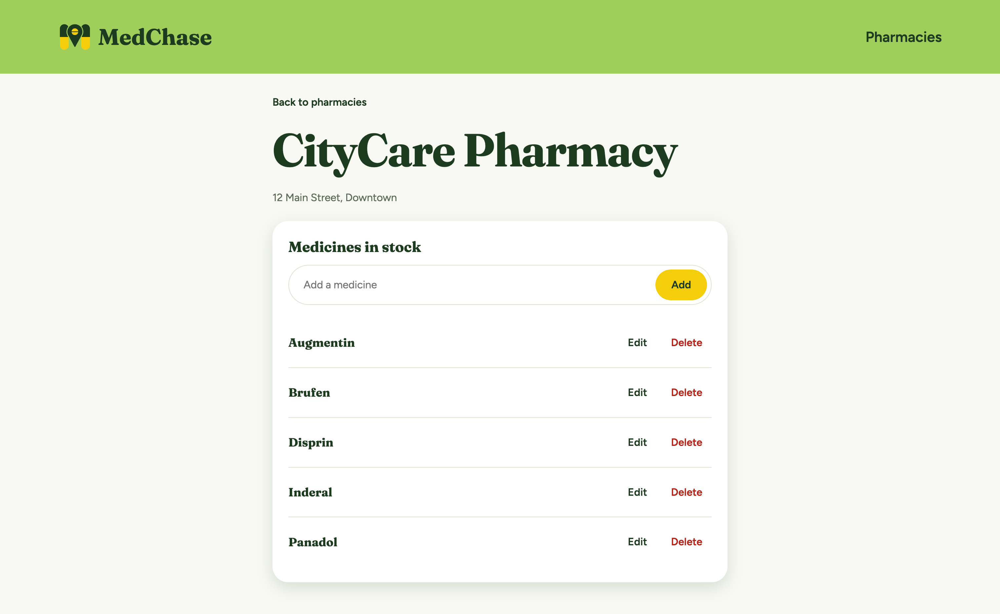
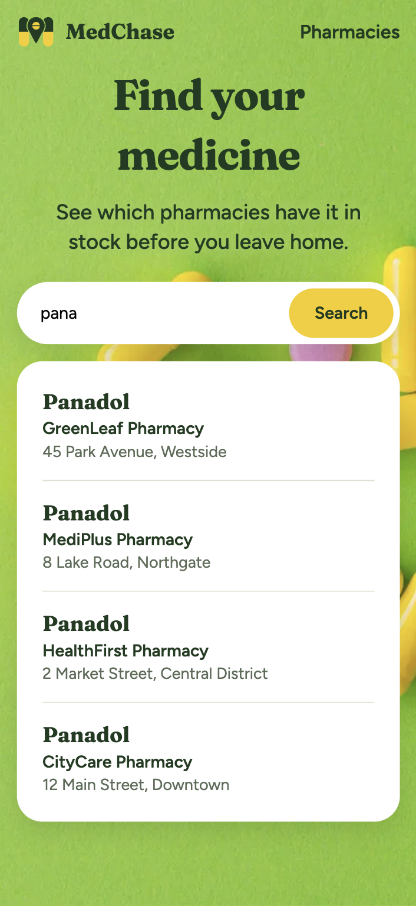

<p align="center">
  
</p>

<h1 align="center">MedChase</h1>

<p align="center">
  Find which pharmacy has your medicine before you leave home.
</p>

<p align="center">
  <a href="https://medchase.vercel.app"><strong>Live demo →</strong></a>
</p>



## The problem

A patient gets a prescription and walks into the nearest pharmacy. It might have the medicine, or it might not. If it doesn't, they try the next one, and the next. There's no way to check in advance.

MedChase fixes that. Pharmacies list the medicines they have in stock, and patients search by name to see which pharmacies have it and where they are.

## Features

**For patients**

- Search a medicine by name and see every pharmacy that has it, with its location
- Results appear as you type (debounced, so the server isn't hit on every key)
- Partial and case-insensitive matching: `pana` finds `Panadol`
- A clear "Not available at any pharmacy" message when nothing matches

**For pharmacies**

- Register a pharmacy with a name and location
- View the pharmacy's stock, sorted A–Z
- Add, rename and delete medicines
- The same medicine can't be added twice to one pharmacy (case-insensitive check)

**Overall**

- Responsive design, built mobile-first, works on phones, tablets and desktops

## Screenshots

| Search results                                 | Pharmacies                                          |
| ---------------------------------------------- | --------------------------------------------------- |
|  |  |

| Pharmacy stock                                              | Mobile                                                                         |
| ----------------------------------------------------------- | ------------------------------------------------------------------------------ |
|  |  |

## Tech stack

| Part       | Tech                          |
| ---------- | ----------------------------- |
| Frontend   | HTML, CSS, vanilla JavaScript |
| Backend    | Node.js, Express              |
| Database   | MongoDB Atlas with Mongoose   |
| Deployment | Vercel                        |

## API

| Method | Route                           | What it does                                     |
| ------ | ------------------------------- | ------------------------------------------------ |
| GET    | `/api/pharmacies`               | All pharmacies                                   |
| POST   | `/api/pharmacies`               | Register a pharmacy (`name`, `location`)         |
| GET    | `/api/pharmacies/:id`           | One pharmacy with its medicines (A–Z)            |
| POST   | `/api/pharmacies/:id/medicines` | Add a medicine (no duplicates per pharmacy)      |
| PATCH  | `/api/medicines/:id`            | Rename a medicine                                |
| DELETE | `/api/medicines/:id`            | Delete a medicine                                |
| GET    | `/api/search?medicine=name`     | Medicines matching the name, with their pharmacy |

Errors come back as JSON in one shape, `{ "message": "..." }`, with the right status code (`400`, `404`, `409` or `500`).

## Run it locally

You'll need Node.js 22 or newer and a free [MongoDB Atlas](https://www.mongodb.com/atlas) cluster.

```bash
git clone https://github.com/abdulmanaan/medchase.git
cd medchase
npm install
```

Create a `.env` file in the project root:

```
MONGODB_URI=your-mongodb-connection-string
```

Start the dev server:

```bash
npm run dev
```

Open [http://localhost:3000](http://localhost:3000).

## Project structure

```
medchase/
├── models/
│   ├── Pharmacy.js       # Pharmacy schema
│   └── Medicine.js       # Medicine schema, linked to a pharmacy
├── public/
│   ├── css/style.css
│   ├── images/
│   ├── js/
│   │   ├── search.js     # Home page search
│   │   ├── pharmacies.js # Pharmacy list and register form
│   │   └── pharmacy.js   # Stock page: add, edit, delete
│   ├── index.html
│   ├── pharmacies.html
│   └── pharmacy.html
├── docs/
│   ├── PLANNING.md       # Planning doc with wireframes
│   ├── wireframes/
│   └── screenshots/
├── server.js             # Express app and API routes
└── package.json
```

## Known limitations

- There's no login yet, so anyone can edit any pharmacy's stock. This was a deliberate choice for v1, to focus on the backend first. Pharmacy accounts are the first thing on the roadmap.
- The data that you see is not real. It is only used as an example to test the app. So the pharmacies and its medicines are not exist in real.

## Roadmap

- Pharmacy accounts with login
- Stock quantity and medicine strength (e.g. Panadol 500mg)
- Search a full prescription at once
- Pharmacies on a map with directions
- Multiple cities
- Search suggestions while typing

## Author

Built by **Abdul Manan** · [GitHub](https://github.com/abdulmanaan) · [LinkedIn](https://linkedin.com/in/abdulmanaan)
