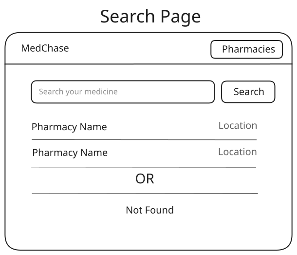
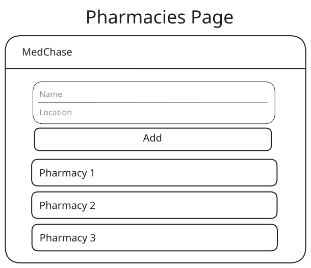
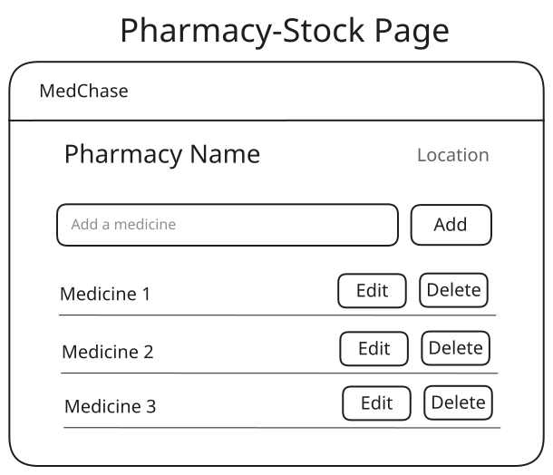

# MedChase

# MedChase - Planning Doc

**Version:** v1
**Author:** Abdul Manan
**Status:** v1 done
**Date:** October 2026

---

## 1. Problem

A patient visits a doctor and gets a prescription. The patient doesn't know which pharmacy has those medicines, so they go to any pharmacy and ask. The pharmacy may have all of them, some of them, or none. If not, the patient goes to another pharmacy, then another.

This wastes the patient's time, and there's no way to confirm in advance which pharmacy has the medicine. The problem repeats every time a patient switches doctors and gets a new prescription.

## 2. Solution

A web app where:

- **Pharmacies** add and update the medicines they have in stock.
- **Patients** search a medicine by name and instantly see which pharmacies have it, along with their location.

## 3. Users

| User     | What they want                                         |
| -------- | ------------------------------------------------------ |
| Patient  | Find which pharmacy has a medicine before leaving home |
| Pharmacy | List their stock so patients can find them             |

## 4. v1 Features

### Patient

- Search a medicine by name
- Search ignores capital/small letters (`panadol` = `Panadol`) and matches partial names (`pana` finds `Panadol`)
- See the list of pharmacies that have the medicine, with each pharmacy's location
- See a clear "Not available at any pharmacy" message when nothing is found

### Pharmacy

- Register a pharmacy (name, location)
- Select their pharmacy from the list
- View their medicine stock
- Add a medicine
- Edit a medicine name
- Delete a medicine
- Same medicine can't be added twice in one pharmacy

## 5. Out of Scope (Future Versions)

- **Pharmacy accounts (login):** each pharmacy manages only its own stock
- **Quantity:** show how many units each pharmacy has
- **Strength:** medicine strength in mg (e.g. Panadol 500mg)
- **Full prescription search:** search multiple medicines at once and see which pharmacy has all of them
- **Live location:** show pharmacies on Google Maps with directions
- **Multiple cities:** search within the patient's city
- **Search suggestions dropdown:** show matching medicine names while typing, pick one to see results
- **Pharmacy search:** filter the pharmacies list by name when it gets long

## 6. Known Limitations (v1)

- No login, so anyone can edit any pharmacy's stock. Accepted for v1 since the goal is learning the backend first. Fixed in the version with pharmacy accounts.
- It is not based on real data. The data is used only for testing. The pharmacies and medicines it have are not real.

## 7. Assumptions

- All pharmacies are in one city.
- Location is plain text (area + address), not GPS.
- Medicine names are typed in English.

## 8. Pages

### Page 1: Search (Home)

The main page. Search box + Search button. Results show pharmacy name and location. Small link at the top: "For pharmacies".

### Page 2: Pharmacies

List of all registered pharmacies. A form to register a new pharmacy. Clicking a pharmacy opens its stock page.

### Page 3: Pharmacy Stock

Pharmacy name and location at the top. Input + Add button. Each medicine row has Edit and Delete buttons.

## 9. Data (Draft)

**Pharmacy**

- name
- location

**Medicine** (stock item)

- name
- pharmacy (reference to Pharmacy \_id)

## 10. API Endpoints

| Method | Route                         | What it does                                                                 |
| ------ | ----------------------------- | ---------------------------------------------------------------------------- |
| GET    | /api/pharmacies               | All pharmacies                                                               |
| POST   | /api/pharmacies               | Register a pharmacy (name, location)                                         |
| GET    | /api/pharmacies/:id           | One pharmacy with its medicines (A-Z)                                        |
| POST   | /api/pharmacies/:id/medicines | Add a medicine (no duplicates per pharmacy)                                  |
| PATCH  | /api/medicines/:id            | Edit a medicine name                                                         |
| DELETE | /api/medicines/:id            | Delete a medicine                                                            |
| GET    | /api/search?medicine=name     | Medicines matching the name, with their pharmacy (partial, case-insensitive) |

## 11. Tech Stack

| Part       | Tech                      |
| ---------- | ------------------------- |
| Frontend   | HTML, CSS, JavaScript     |
| Backend    | Node.js, Express          |
| Database   | MongoDB (Atlas free tier) |
| Deployment | Vercel                    |

## 12. Definition of Done (v1)

- [x] A pharmacy can register and add, edit and delete its medicines
- [x] A patient can search a medicine and see which pharmacies have it, with location
- [x] Data is saved in MongoDB and stays after a page refresh
- [x] Works on mobile and desktop
- [x] Code pushed to GitHub with a README
- [x] Deployed live
